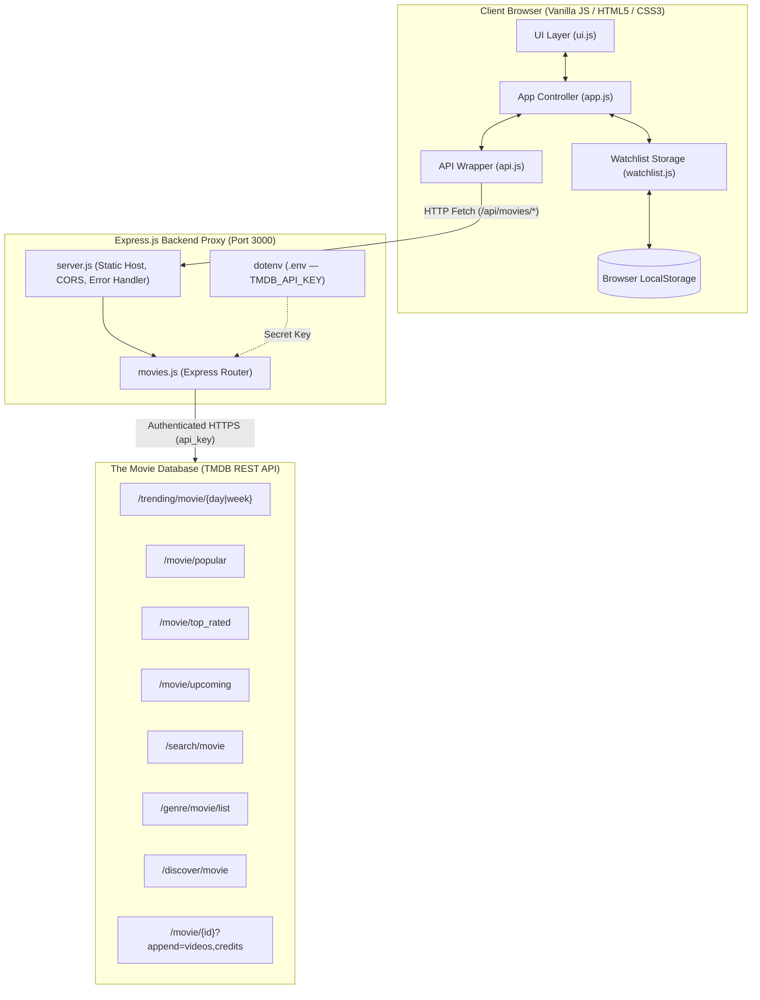
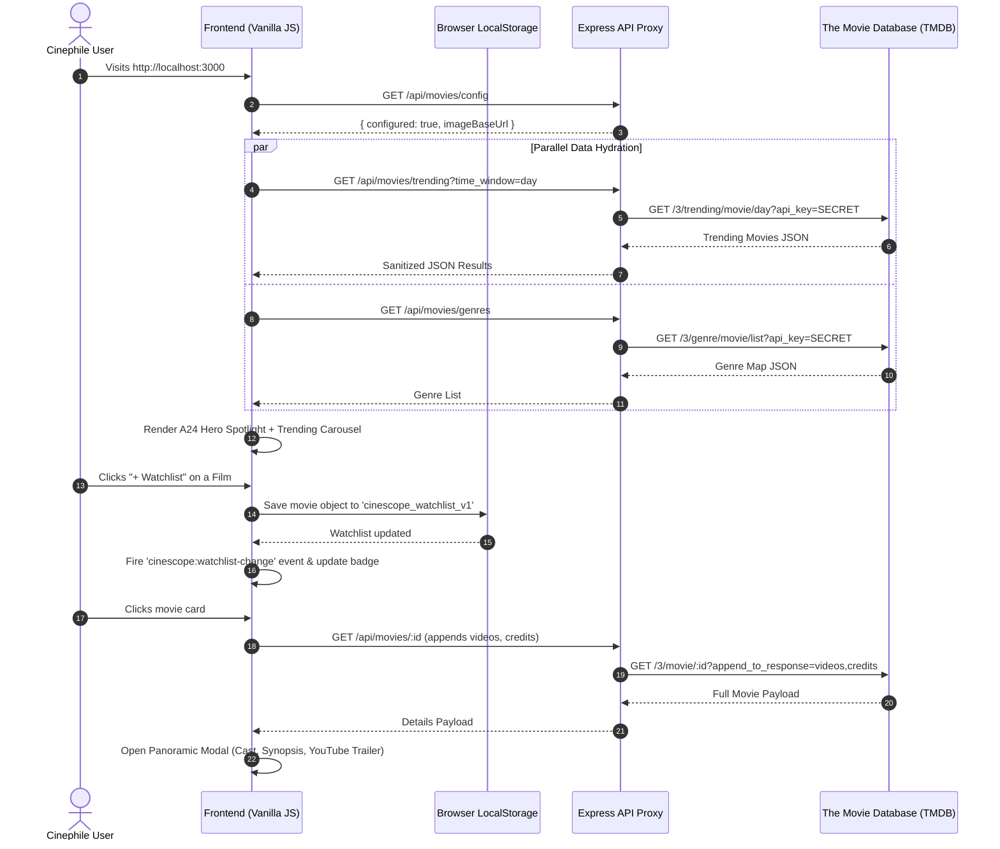

# ❖ CINESCOPE — Cinematic Movie Discovery Platform

> An editorial movie discovery archive blending the cinematic storytelling of **A24**, the pristine visual polish of **Apple TV+**, and the thoughtful browsing curation of **Letterboxd**. Powered by **The Movie Database (TMDB) REST API** through a secure Node.js & Express proxy.

---

## 🏛️ System Architecture

CineScope separates concerns into a clean, decoupled architecture:
1. **Frontend Client**: Vanilla JavaScript (ES6+), semantic HTML5, and bespoke CSS3 with zero heavyweight UI frameworks.
2. **Backend Proxy Layer**: Node.js & Express proxy server that safeguards TMDB credentials, standardizes responses, and manages cross-origin traffic.
3. **Upstream API**: The Movie Database (TMDB) v3/v4 REST endpoints providing real-time global cinema data.



---

## 🔄 Interaction & Security Sequence Flow



---

## ✨ Features & Design Philosophy

### 1. Aesthetic & Visual Identity
- **A24 / Apple TV+ / Letterboxd Harmony**: Deep charcoal canvas (`#090a0c`), subtle warm gold (`#c5a059`) and muted crimson (`#be123c`) accents.
- **Editorial Typography**: [Cinzel](https://fonts.google.com/specimen/Cinzel) and [Playfair Display](https://fonts.google.com/specimen/Playfair+Display) for titles, paired with [Plus Jakarta Sans](https://fonts.google.com/specimen/Plus+Jakarta+Sans) for metadata.
- **Architectural Radii**: Refined 4px–6px corners rather than bubbly generic cards.
- **Zero Emojis**: Clean SVG line iconography and editorial section numbering (`01 / WHAT'S BUZZING`, `02 / AUDIENCE ACCLAIM`, `03 / MASTERPIECES`, `04 / COMING SOON`).

### 2. Core Modules
- **Featured Spotlight**: Expansive full-bleed hero artwork with multi-directional optical vignettes, storyline synopsis, rating badges, and one-click actions.
- **Trending Poster Carousel**: Smooth horizontal carousel with prev/next slider controls and Day/Week toggle.
- **Dynamic Live Search**: Real-time 400ms debounced search bar with instant results display and "Return to Catalog" restore.
- **Genre Directory**: 19 interactive genre filters fetched dynamically from TMDB `/genre/movie/list`.
- **Panoramic Movie Modal**: High-res backdrop header, full storyline, cast headshots, and embedded YouTube trailer player.
- **Persistent Watchlist**: `localStorage`-backed watchlist with navbar badge and dedicated collection view.

### 3. Security
- **No Client Key Exposure**: Your TMDB API key resides strictly in server-side `.env`.
- **Supports Both v3 & v4 Auth**: Accepts 32-character v3 API keys as well as JWT v4 Bearer Tokens (`ey...`).
- **Graceful Error Recovery**: If an API key is missing or misconfigured, the app returns HTTP 503 with helpful setup instructions without crashing.

---

## 📁 Repository Structure

```text
CineScope/
├── public/
│   ├── css/
│   │   └── style.css          # Architectural dark theme, responsive grid, animations
│   ├── js/
│   │   ├── api.js             # Client-side API fetch client calling Express proxy
│   │   ├── app.js             # Application controller, routing, search & events
│   │   ├── ui.js              # DOM rendering, hero, carousel, modal & toast alerts
│   │   └── watchlist.js       # LocalStorage manager & custom event bus
│   └── index.html             # Semantic SPA layout & typography links
├── server/
│   ├── routes/
│   │   └── movies.js          # Express router proxying all TMDB API requests
│   └── server.js              # Express app, static file server & error handling
├── .env.example               # Template for environment variables
├── .gitignore                 # Excludes .env, node_modules, and system artifacts
├── package.json               # Node.js project manifest & scripts
└── README.md                  # Comprehensive architectural documentation
```

---

## 🚀 Getting Started

### 1. Prerequisites
- **Node.js** v18.0.0 or higher
- **npm** v9.0.0 or higher

### 2. Clone the Repository
```bash
git clone https://github.com/gayathris-dev/CineScope.git
cd CineScope
```

### 3. Install Dependencies
```bash
npm install
```

### 4. Configure Environment Variables
Copy `.env.example` to `.env`:
```bash
cp .env.example .env
```

Open `.env` and insert your TMDB API Key:
```env
PORT=3000
TMDB_API_KEY=your_actual_tmdb_api_key_here
TMDB_BASE_URL=https://api.themoviedb.org/3
TMDB_IMAGE_BASE_URL=https://image.tmdb.org/t/p
```

> **Obtaining a Free TMDB API Key**:
> 1. Sign up or log in at [The Movie Database](https://www.themoviedb.org/).
> 2. Navigate to **Settings** &rarr; **API** &rarr; **Request an API Key**.
> 3. Select **Personal** / **Educational**, copy your **API Key (v3)** or **Read Access Token (v4)**, and paste it into `.env`.

### 5. Launch Application
For production:
```bash
npm start
```

For development (with automatic restarts via nodemon):
```bash
npm run dev
```

Visit **`http://localhost:3000`** in your browser.

---

## 📡 Proxy API Reference

All frontend requests target the local Express proxy:

| Method | Endpoint | Query Parameters | Upstream TMDB Route | Description |
|---|---|---|---|---|
| `GET` | `/api/movies/config` | — | Internal | Checks API key status & image resolutions |
| `GET` | `/api/movies/trending` | `time_window` (`day`\|`week`), `page` | `/trending/movie/{time_window}` | Trending cinema feed |
| `GET` | `/api/movies/popular` | `page` | `/movie/popular` | Global popular releases |
| `GET` | `/api/movies/top-rated` | `page` | `/movie/top_rated` | Critically acclaimed titles |
| `GET` | `/api/movies/upcoming` | `page` | `/movie/upcoming` | Upcoming theater releases |
| `GET` | `/api/movies/genres` | — | `/genre/movie/list` | Official movie genre taxonomy |
| `GET` | `/api/movies/discover` | `with_genres`, `sort_by`, `page` | `/discover/movie` | Filtered genre discovery |
| `GET` | `/api/movies/search` | `query` (required), `page` | `/search/movie` | Text search across titles |
| `GET` | `/api/movies/:id` | — | `/movie/{id}?append_to_response=...` | Full metadata, credits, videos |
| `GET` | `/api/health` | — | Internal | System health check |

---

## ⚖️ Attribution & License

- Movie metadata and artwork provided by [The Movie Database (TMDB)](https://www.themoviedb.org/). This product uses the TMDB API but is not certified or endorsed by TMDB.
- Released under the [MIT License](LICENSE).
